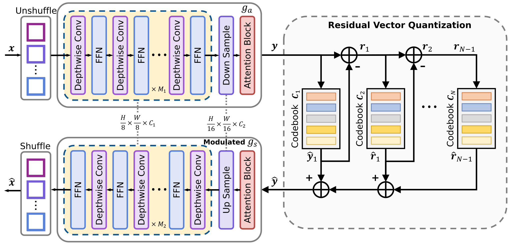
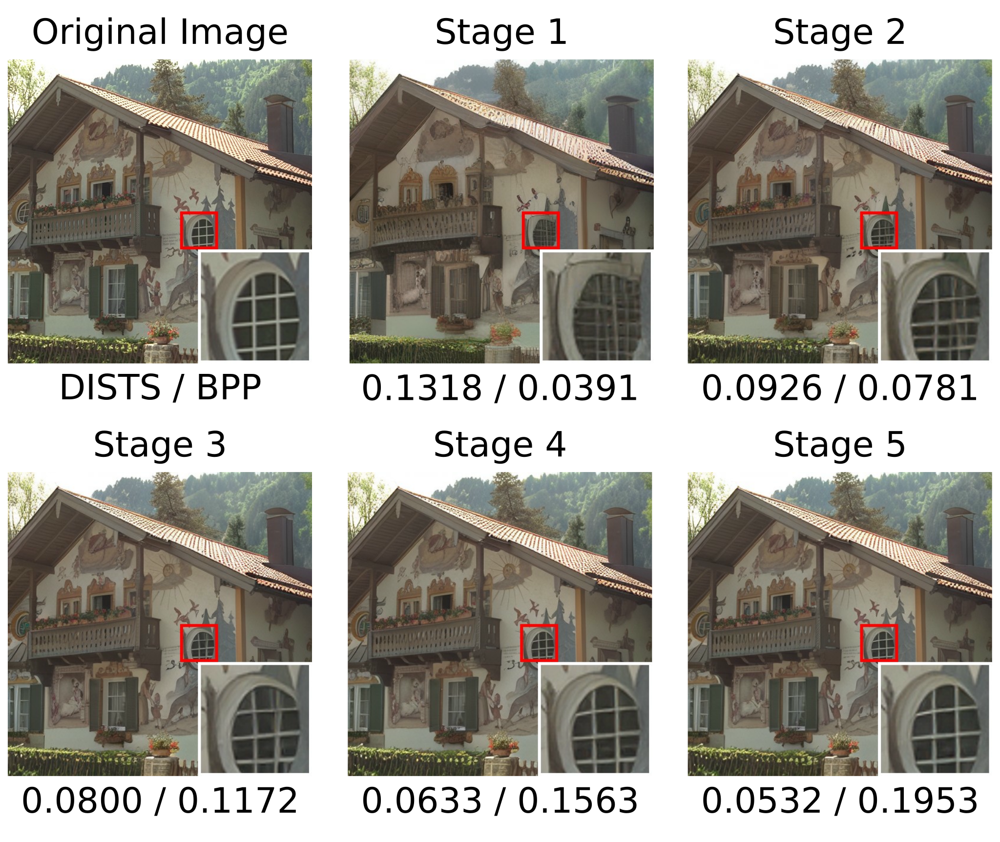

# ProGIC: Progressive and Lightweight Generative Image Compression with Residual Vector Quantization

[](https://arxiv.org/abs/2603.02897)

Inference code for **ProGIC**, with base and small checkpoints, five rate points, and progressive reconstruction from residual codebook indices.

**Hao Cao, Chengbin Liang, Wenqi Guo, Zhijin Qin, Jungong Han**

## Overview

ProGIC combines residual vector quantization with a lightweight image codec. Successive codebooks refine the reconstruction, so the receiver can decode a preview from an initial prefix and improve it as more stages arrive. The backbone uses depthwise convolutions and attention blocks for execution on GPUs and CPUs. See the [paper](https://arxiv.org/abs/2603.02897) for the method and reported comparisons.

<p align="center">
  
</p>

## Repository layout

```text
.
├── ProGIC.py              # self-contained inference model
├── test.py                # quality and latency evaluation
├── requirements.txt
├── tests/
│   └── test_inference.py  # checkpoint and progressive decoding tests
├── pic/                  # original ProGIC paper figures
├── ckpt/                 # local weights, excluded from Git
│   ├── ckpt.pth.tar       # base model
│   └── ckpt_s.pth.tar     # small model
└── kodak/                # local test images, excluded from Git
```

## Environment

Install PyTorch and torchvision for your CPU or CUDA environment, then install the remaining dependencies:

```bash
conda create -n progic python=3.12 -y
conda activate progic
pip install torch torchvision
pip install -r requirements.txt
```

The model itself only requires PyTorch. Evaluation uses NumPy and Pillow, with LPIPS and DISTS for perceptual metrics. The first perceptual evaluation may download pretrained VGG weights. Use `--skip-perceptual` for offline inference without these weights.

## Pretrained checkpoints

| Variant | Checkpoint | Encoder channels / blocks | Decoder channels / blocks |
| --- | --- | --- | --- |
| Base | `ckpt/ckpt.pth.tar` | 368 / 8 | 368 / 14 |
| Small | `ckpt/ckpt_s.pth.tar` | 256 / 4 | 256 / 8 |

Both variants use five residual codebooks with 1,024 entries each. The existing local checkpoints remain usable without conversion. Public download links have not yet been added. The EF-LIC checkpoint is a different model and cannot be used here.

## Test on Kodak

Evaluate the base model at all five rates, using CUDA when available:

```bash
python test.py
```

Select the small model or specify paths:

```bash
python test.py --variant small
python test.py --kodak-dir kodak --ckpt-path ckpt/ckpt.pth.tar --device cuda:0
```

Run a CPU smoke test without downloading perceptual metric weights:

```bash
python test.py --variant small --device cpu --limit 1 --skip-perceptual
```

Save reconstructions and per-image measurements:

```bash
python test.py --index 0 2 4 --save-dir output/base --csv results/base.csv
```

Images retain their original dimensions. The evaluator pads to multiples of 16 and crops the reconstruction back to the input size. To explicitly benchmark resized images, pass `--resize HEIGHT WIDTH`, for example `--resize 256 256`.

For each image, the script reports encoding time, decoding time, PSNR, BPP, LPIPS and DISTS. It also prints arithmetic means over the selected images at each rate. With `--skip-perceptual`, LPIPS and DISTS are omitted.

### Rate and timing conventions

`--index 0 1 2 3 4` uses one, two, three, four or five codebooks. Each index uses 10 bits. For dimensions divisible by 16, the nominal rates are:

| Index | Codebooks | Index bits per pixel |
| --- | --- | --- |
| 0 | 1 | 0.0390625 |
| 1 | 2 | 0.0781250 |
| 2 | 3 | 0.1171875 |
| 3 | 4 | 0.1562500 |
| 4 | 5 | 0.1953125 |

The evaluator packs indices into bytes and measures the actual payload size. BPP includes byte alignment and spatial padding, but excludes the separately retained shape metadata and transport headers. This is an in-memory payload evaluation, not a standalone compressed-file format.

Encoding time includes neural encoding and CPU bit packing. Decoding time includes unpacking, transfer to the selected device and neural decoding. CUDA is synchronized around measurements. Each rate has an untimed model warmup. Image loading, metric computation and saving are excluded. Timings depend on hardware, resolution and thread count (`--threads`, default 4).

## Progressive decoding

```python
import torch
from ProGIC import ProGIC
from test import load_image, pad_image

device = torch.device("cpu")
net = ProGIC("base").to(device).eval()
checkpoint = torch.load("ckpt/ckpt.pth.tar", map_location="cpu", weights_only=True)
net.load_state_dict(checkpoint["state_dict"])

x = load_image("kodak/1.png", device)  # replace with an image filename in your dataset
height, width = x.shape[-2:]
indices = net.compress(pad_image(x), index=4)
preview = net.decompress(indices[:1])[..., :height, :width]
full = net.decompress(indices)[..., :height, :width]
```

Inputs and reconstructions use `[-1, 1]`. Returned indices retain their spatial dimensions. A separate decoder instance with the same weights can reconstruct them without a preceding encode call. Clip reconstructions to `[-1, 1]` before image export or metric calculation.

## Paper figures

Progressive reconstructions from the original ProGIC paper:

<p align="center">
  
</p>

These are paper illustrations, not measurements generated by this repository cleanup. New evaluation results can be exported with `--csv`.

## Tests

With both local checkpoints available:

```bash
python -m unittest discover -s tests -v
```

The tests cover strict checkpoint loading, all five rates, independent decoding, progressive prefixes, bit packing and non-multiple-of-16 image dimensions. Point `PROGIC_CHECKPOINT_DIR` to another checkpoint directory if necessary.

## Citation

```bibtex
@article{cao2026progic,
  title   = {ProGIC: Progressive and Lightweight Generative Image Compression with Residual Vector Quantization},
  author  = {Cao, Hao and Liang, Chengbin and Guo, Wenqi and Qin, Zhijin and Han, Jungong},
  journal = {arXiv preprint arXiv:2603.02897},
  year    = {2026}
}
```

## Acknowledgements

The release layout follows [EF-LIC](https://github.com/SevenCTHU/EF-LIC). The model retains the existing ProGIC layers and checkpoint parameter names. Attention-layer attribution is preserved in `ProGIC.py`.

## Contact

caoh24[at]mails.tsinghua.edu.cn
